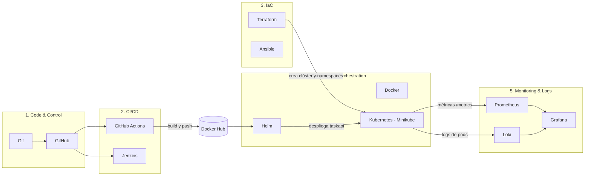

# devops-full-cycle


Proyecto de laboratorio que recorre el **ciclo DevOps completo** con una app Flask (`taskapi`): control de versiones, CI/CD, infraestructura como código, contenedores, orquestación y observabilidad. Todo corre en local (WSL2 + Docker + Minikube), sin coste de nube.

## Arquitectura



| Etapa | Herramientas | Qué hace en este proyecto |
|---|---|---|
| 1. Code & Control | Git, GitHub | Repo por SSH, historial de commits, workflows |
| 2. CI/CD | GitHub Actions, Jenkins | Tests, build de la imagen y push a Docker Hub (Actions); pipeline de build y test (Jenkins) |
| 3. IaC | Terraform, Ansible | Terraform crea el clúster Minikube y los namespaces; Ansible prepara el host |
| 4. Containers | Docker, Kubernetes, Helm | Imagen de la app, despliegue con un chart propio (2 réplicas, probes, límites) |
| 5. Monitoring | Prometheus, Grafana, Loki | Métricas de la app vía ServiceMonitor y logs JSON centralizados |

## Estructura del repositorio

```
devops-full-cycle/
├── .github/workflows/ci.yaml   # CI: test + build + push a Docker Hub
├── ansible/                    # inventory.ini y bootstrap.yml
├── helm/taskapi/               # Chart: deployment, service, servicemonitor
├── jenkins/Dockerfile          # Jenkins con cliente Docker
├── src/                        # App Flask, tests y Dockerfile
├── terraform/main.tf           # Clúster Minikube y namespaces
├── Jenkinsfile                 # Pipeline de Jenkins
└── README.md
```

## La aplicación

API mínima en Flask servida con gunicorn:

| Ruta | Respuesta |
|---|---|
| `/` | `{"message": "Hola DevOps", "version": "1.0.0"}` |
| `/health` | `{"status": "ok"}` (la usan los probes de Kubernetes) |
| `/metrics` | Métricas en formato Prometheus (`taskapi_requests_total`) |

Escribe logs en JSON por stdout, que Promtail recoge y envía a Loki.

## Requisitos

- Windows con **WSL2 (Ubuntu)** y **Docker Desktop** con integración WSL activada
- Git, Terraform, kubectl, Minikube, Helm, Ansible y Python 3
- Cuenta de GitHub con una clave SSH y cuenta de Docker Hub
- Unos 8 GB de RAM libres para Minikube con la pila de monitoreo

## Cómo reproducirlo

### 1. Clonar y probar la app

```bash
git clone git@github.com:ASMODAX-OPS/devops-full-cycle.git
cd devops-full-cycle

python3 -m venv .venv && source .venv/bin/activate
pip install -r src/requirements.txt
python -m pytest src                      # debe terminar con "1 passed"
```

### 2. Construir y ejecutar el contenedor

```bash
docker build -t taskapi:dev src
docker run --rm -p 5000:5000 taskapi:dev
curl localhost:5000/health                # en otra terminal
```

### 3. CI con GitHub Actions

Crea estos secretos en *Settings → Secrets and variables → Actions → New repository secret*:

| Secreto | Valor |
|---|---|
| `DOCKERHUB_USERNAME` | tu usuario de Docker Hub |
| `DOCKERHUB_TOKEN` | token de acceso con permisos Read & Write |

Cada push a `main` ejecuta los tests y publica `taskapi:<sha>` y `taskapi:latest` en Docker Hub.

### 4. Infraestructura con Terraform

```bash
cd terraform
terraform init
terraform fmt && terraform validate
terraform plan -out=tfplan
terraform apply tfplan
kubectl get nodes                         # nodo Ready
kubectl get ns                            # app y monitoring
cd ..
```

### 5. Preparar el host con Ansible

```bash
sudo $(which ansible-playbook) -i ansible/inventory.ini ansible/bootstrap.yml --check -e ansible_python_interpreter=/usr/bin/python3
sudo $(which ansible-playbook) -i ansible/inventory.ini ansible/bootstrap.yml -e ansible_python_interpreter=/usr/bin/python3
```

Una segunda ejecución debe mostrar `changed=0` (el playbook es idempotente).

### 6. Desplegar la app con Helm

```bash
helm lint helm/taskapi
helm install taskapi helm/taskapi -n app
kubectl -n app get pods                   # 2 pods 1/1 Running
kubectl -n app port-forward svc/taskapi 8081:80
curl localhost:8081
```

Para usar otra imagen: `helm upgrade taskapi helm/taskapi -n app --set image.tag=<sha>`.

### 7. Monitoreo: Prometheus, Grafana y Loki

```bash
helm repo add prometheus-community https://prometheus-community.github.io/helm-charts
helm repo add grafana https://grafana.github.io/helm-charts
helm repo update

helm install kps prometheus-community/kube-prometheus-stack -n monitoring --timeout 10m
helm install loki grafana/loki-stack -n monitoring --set promtail.enabled=true

helm upgrade taskapi helm/taskapi -n app --set metrics.enabled=true
```

Acceso a las interfaces:

```bash
kubectl -n monitoring port-forward svc/kps-grafana 3000:80
kubectl -n monitoring port-forward svc/kps-kube-prometheus-stack-prometheus 9090:9090
kubectl -n monitoring get secret kps-grafana -o jsonpath="{.data.admin-password}" | base64 -d; echo
```

- Prometheus (`localhost:9090`): *Status → Targets* debe mostrar `taskapi` en `UP`. Consulta `taskapi_requests_total`.
- Grafana (`localhost:3000`, usuario `admin`): añade Loki como fuente de datos con URL `http://loki:3100` y consulta `{namespace="app"}` en *Explore*.

### 8. Jenkins

```bash
docker build -t jenkins-lab jenkins
docker run -d --name jenkins --user root -p 8080:8080 -v jenkins_home:/var/jenkins_home -v /var/run/docker.sock:/var/run/docker.sock jenkins-lab
docker exec jenkins cat /var/jenkins_home/secrets/initialAdminPassword
```

En `http://localhost:8080` instala el plugin **Docker Pipeline** y crea un job *Pipeline script from SCM* con el repo, una credencial SSH de solo lectura y `Jenkinsfile` como *Script Path*.

## Capturas


*Grafana mostrando las métricas de `taskapi` (Prometheus) en el namespace `app`.*

## Decisiones de seguridad

- **Secretos fuera del código:** credenciales de Docker Hub en GitHub Secrets; `.gitignore` excluye `.env`, `*.tfstate*`, `*.tfvars` y `.terraform/`.
- **Llaves separadas:** una llave SSH personal para empujar código y una *deploy key* de **solo lectura** para Jenkins.
- **Contenedor sin root:** el `Dockerfile` crea y usa un usuario sin privilegios.
- **Límites y probes** en el Deployment (`requests`, `limits`, readiness y liveness).
- **Verificación de host SSH** en Jenkins.
- **Aviso:** Jenkins monta `/var/run/docker.sock`, lo que equivale a dar root sobre el host. Es aceptable en un laboratorio local y no debe usarse en producción ni exponerse a internet.

## Próximos pasos

- Escaneo de la imagen con **Trivy** y del código con **Semgrep** en la CI (DevSecOps)
- **ArgoCD** para pasar del `helm upgrade` manual a GitOps
- Reglas de alerta en Prometheus y dashboard propio de `taskapi` en Grafana
- Sustituir `loki-stack` (obsoleto) por `grafana/loki` y Alloy

## Limpieza

```bash
helm uninstall taskapi -n app
helm uninstall kps loki -n monitoring
cd terraform && terraform destroy
docker rm -f jenkins
```

## Autor

[ASMODAX-OPS](https://github.com/ASMODAX-OPS)
